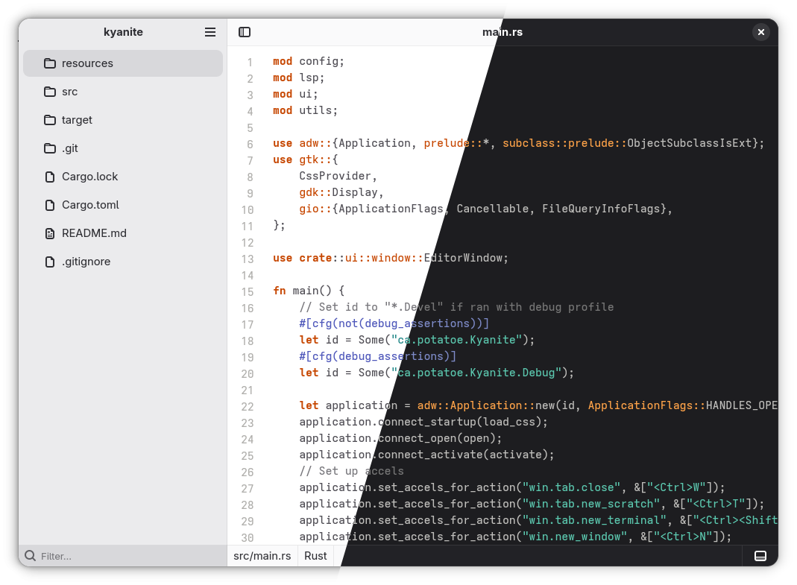
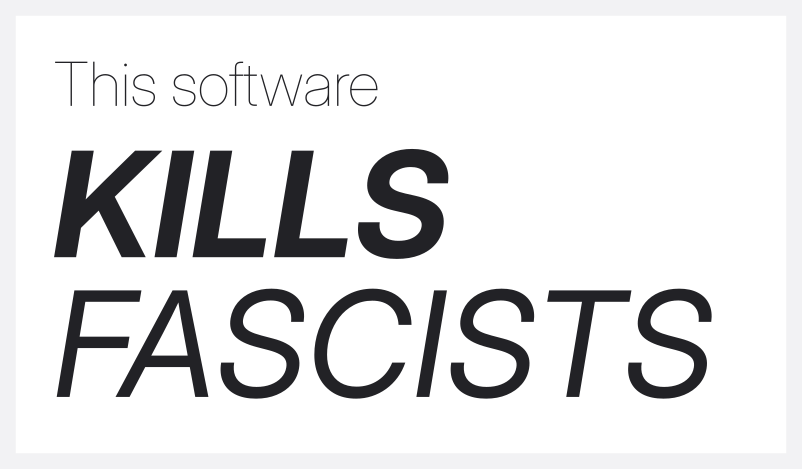

<h1>  Kyanite </h1>


A lightweight, graphical text editor.



<small>(see resources/screenshots for more screenshots)</small>


## Features
- File tree!
- VTE (virtual terminal library) support - aka built-in terminal windows!
- Searching text!
- LSP support:
  - Configurable language servers!
  - Inline diagnostics!
  - Code completion!
- gtksourceview5 goodies:
  - Syntax highlighting!
  - Themes!
    - Window recoloring to match themes (like GNOME Builder)!
- Adaptive UI (aka works on phones)!

## Obtaining Kyanite

[](https://repology.org/project/kyanite/versions)

### Weekly builds
Kyanite has [weekly builds](https://codeberg.org/pastthepixels/kyanite/actions) via Codeberg Actions. Download an executable and proceed to *Installing metadata* for icons and a desktop shortcut. These builds are from source, so there are no guarantees you'll have a stable experience.

### Nix

Kyanite is packaged as a nix flake in this repo.

To try it without installing:

```bash
nix run git+https://codeberg.org/pastthepixels/kyanite
```

To use it from a flake, add it to the flake inputs:

```nix
inputs.kyanite.url = "git+https://codeberg.org/pastthepixels/kyanite";
```

You can then access the package with `kyanite.packages.${system}.kyanite`.

### Build from source

#### Dependencies (install these first)
- rust >= 1.92.0
- gtksourceview5 >= 5.18
- libadwaita >= 1.8
- gtk4 >= 4.20
- libpanel
- vte4 >= 0.78
- blueprint-compiler

On Arch Linux, that looks like: `pacman -S rust gtksourceview5 libadwaita gtk4 libpanel vte4 blueprint-compiler`

#### Running
- Release build: `cargo run --release`
- Debug build: `cargo run`

#### Installing manually
Running `cargo install --path .` will build Kyanite and install the editor command, `ky`, to your user directory (`~/.cargo/bin`).

### Installing metadata

If you're on Linux, `resources/metadata/ca.potatoe.Kyanite.desktop` to `~/.local/share/applications/` to set up a shortcut for Kyanite that's locally installed in your home directory (you can remove it any time). You may wish to copy the application icon `resources/icons/scalable/apps/ca.potatoe.Kyanite.svg` to `~/.local/share/icons` if you want an icon to show up on the shortcut.

## Contribute
This is a huge work-in-progress and I'm still working together core features.
That being said, I'll still try to review PRs to the best I can! Anything that helps refine the editor and make it stronger is welcome.
Only thing I ask is the same as all my projects: No "AI" -- that's the reason I made this, and fascists aren't allowed here.


### Where does the name come from?
[CHECK OUT THIS COOL ROCK](https://en.wikipedia.org/wiki/Kyanite)

## Roadmap/TODO

### to 0.5.0 aka "having a stable editor"
- undoing a formatting thingy actually scrolls to the top and it's annoying
- gracefully close lsp when window closes

### preferences menu
- less choppy loading (oh my god)
- tab indentation styles
- language settings
- editor-specific font
- link to open gtksourceview5 themes directory
- link to open gtksourceview5 language defs directory
- link to open kyanite config

### keybinds
- modal by design
  - default mode is always insert
- configurable modes (e.g. you can define your own modes)
- configurable keybinds
  - conditional keybind actions (e.g. only run in a certain mode)
  - multiple binds should be possible

### plugins
- ask charlotte about this, she wants to do it and she has interesting ideas

### Other stuff
- Syntax highlighting with tree-sitter
- Helix-compatible separate LSP config file

-----

<!-- ward off tech bros, if literally everything else wasn't enough -->

# Disclaimer

By using or contributing to this software, you agree that *trans rights are human rights*, *ACAB*, and that *hate has no place here*.


